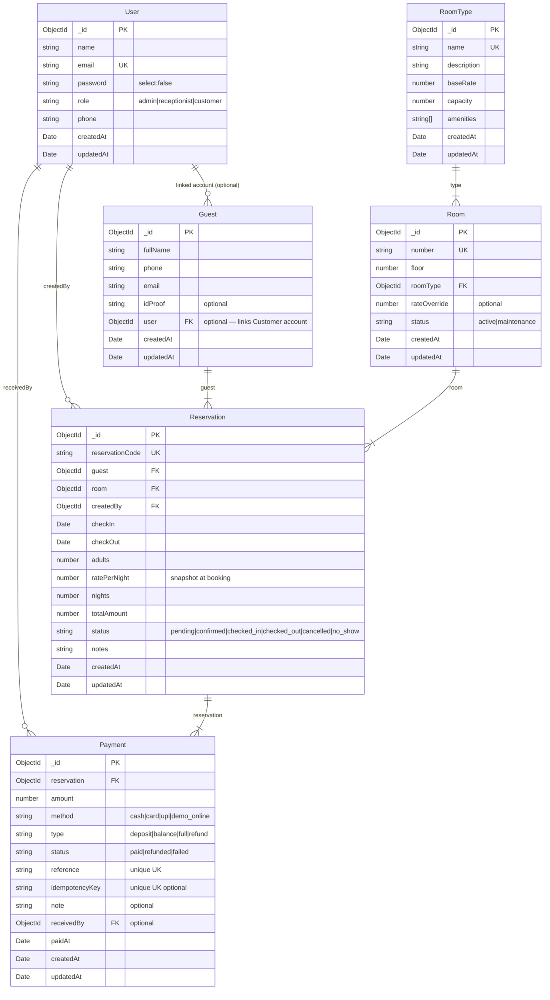

# ER Diagram — Harbour Row Hotel Reservation System

## Key Design Decisions

- **Occupancy is DERIVED**: Room.status only tracks maintenance. Whether a room is occupied is computed from active Reservation records (pending/confirmed/checked_in) — never stored on Room.
- **Rate snapshot**: `ratePerNight` is captured at booking time from the room's `rateOverride` or `roomType.baseRate`. Future rate changes do not affect existing reservations.
- **Balance computation**: `balance = totalAmount - sum(paid payments) + sum(refunded payments)` — computed server-side, never stored.
- **Overlap detection**: Runs inside a Mongoose transaction to prevent race conditions.
- **Indexes**: Room.number (unique), Reservation compound (room, checkIn, checkOut), Guest text index (fullName, email), User.email (unique).

